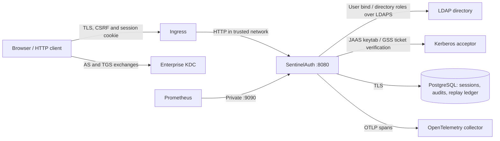
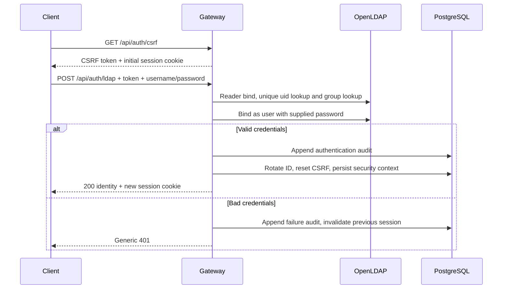

# SentinelAuth

Java 21 / Spring Boot 3 enterprise identity gateway with real LDAP binds, Kerberos SPNEGO through Java GSS-API, directory-backed RBAC, PostgreSQL sessions and append-only authentication audit events. The development stack contains OpenLDAP, an MIT Kerberos KDC, PostgreSQL, Prometheus and an OpenTelemetry collector.

See [VERIFICATION.md](VERIFICATION.md) for observed results and unverified checks, and [SECURITY.md](SECURITY.md) for trust boundaries, scope and deployment requirements.

## Architecture



Only explicitly mapped LDAP groups grant resource access. `sentinel-users` grants `ROLE_USER`; `sentinel-admins` grants `ROLE_ADMIN`. Bob belongs to both. Unknown routes are denied. Kerberos proves possession of a ticket for the HTTP service, then LDAP independently verifies that the mapped user exists and supplies roles. No password is checked against an in-memory substitute.

## Authentication sequences



```mermaid
sequenceDiagram
    participant C as Kerberos client
    participant K as KDC
    participant G as Gateway
    participant L as LDAP
    participant P as PostgreSQL
    C->>K: AS exchange (password / ticket cache)
    K-->>C: TGT
    C->>K: TGS request for HTTP/gateway
    K-->>C: Service ticket
    C->>G: GET /api/auth/csrf
    G-->>C: CSRF token + cookie
    C->>G: POST /api/auth/kerberos, Negotiate token + CSRF
    G->>G: GSS acceptSecContext using service keytab
    G->>G: Validate exact realm and uid syntax
    G->>L: Resolve unique user and explicit groups
    G->>P: Claim raw-token digest; append audit
    G->>P: Rotate session and persist identity
    G-->>C: 200 + mutual-auth Negotiate response + cookie
    C->>C: Verify server response
```

Invalid tickets return 401 with `WWW-Authenticate: Negotiate`. Directory/audit-store failures return 503; no session is created. There is no fallback to another authentication method on a failed ticket.

## Run locally

Requirements: Docker Engine/Desktop with Compose v2, Java 21, Maven 3.9+, Python 3 and curl. Docker is needed for the full end-to-end suite. From this repository:

```bash
python3 scripts/init-local.py
docker compose up -d --build
curl --fail http://localhost:9090/actuator/health/readiness
bash scripts/scenarios.sh
```

Allow up to four minutes for image builds and startup; retry readiness until it returns 200. The gateway restarts if its keytab or directory is not ready at initial startup. Readiness checks LDAP and PostgreSQL. Application: `http://localhost:8080`; management: `http://localhost:9090`; Prometheus: `http://localhost:9091`. All host port mappings bind to loopback. Local credentials are randomly generated in `.secrets/` and `.env`, both ignored by Git. Alice is a user, Bob is a user/admin, and `unprivileged` is a valid LDAP identity with zero roles. The latter shares Alice's generated development password. Alice's LDAP and KDC passwords match only for the local fixture.

Do not rerun initialization to rotate a running database or KDC: their persisted credentials remain unchanged. For a clean reset, stop the stack with `docker compose down -v`, remove `.secrets` and `.env`, then initialize again. This destroys local identity data and audit/session records.

```bash
docker compose logs -f gateway kdc ldap
docker compose logs otel
docker compose down
```

To debug Java on the host while infrastructure runs in Compose:

```bash
docker compose up -d postgres ldap kdc otel
docker compose cp kdc:/keytabs/http.keytab .secrets/http.keytab
mkdir -p work
sed 's/kdc = kdc:1088/kdc = localhost:1088/' infra/kerberos/krb5.conf > work/krb5.conf
export DATABASE_URL=jdbc:postgresql://localhost:5432/sentinel DATABASE_USER=sentinel
export DATABASE_PASSWORD="$(cat .secrets/database_password)"
export LDAP_URL=ldap://localhost:1389 LDAP_BASE_DN=dc=sentinel,dc=test
export LDAP_BIND_DN=uid=reader,dc=sentinel,dc=test
export LDAP_BIND_PASSWORD="$(cat .secrets/reader_password)"
export ALLOW_INSECURE_LDAP=true COOKIE_SECURE=false KERBEROS_REALM=SENTINEL.TEST
export KERBEROS_SERVICE_PRINCIPAL=HTTP/gateway@SENTINEL.TEST KERBEROS_KEYTAB="$PWD/.secrets/http.keytab"
export JAVA_TOOL_OPTIONS="-Djava.security.krb5.conf=$PWD/work/krb5.conf"
mvn spring-boot:run
```

## API

Every POST requires the CSRF token returned by `GET /api/auth/csrf` and the accompanying session cookie. After login, fetch a fresh CSRF token before another POST. JSON responses contain no credentials. Login accepts URL-encoded form data, not JSON. Kerberos uses a POST to avoid unsafe login side effects on GET.

| Method | Path | Authorization / response |
|---|---|---|
| GET | `/api/auth/csrf` | Public; `{token, headerName}` and session cookie |
| POST | `/api/auth/ldap` | Public with CSRF; `username`, `password` form fields; 200 `{username, roles}` |
| POST | `/api/auth/kerberos` | Public with CSRF; `Authorization: Negotiate BASE64_TOKEN`; 200 identity plus optional mutual response header |
| POST | `/api/auth/logout` | CSRF required; invalidates server session; 204 |
| GET | `/api/me` | ROLE_USER; `{username, roles}` |
| GET | `/api/resource` | ROLE_USER; sample protected resource |
| GET | `/api/admin/status` | ROLE_ADMIN; sample protected admin operation |
| GET | `:9090/actuator/health/liveness` | Private process health |
| GET | `:9090/actuator/health/readiness` | Private database/directory readiness |
| GET | `:9090/actuator/prometheus` | Private Prometheus scrape |

Failure responses: 401 `authentication_failed` for invalid credentials, 401 `unauthorized` for anonymous protected requests, 401 `session_expired`, 403 `forbidden` for missing CSRF or insufficient role, 429 `too_many_attempts` with `Retry-After: 60`, 503 `authentication_unavailable` for dependency failure. Missing form parameters are rejected with 400. Unknown routes are denied. The limiter applies to credential POSTs that pass CSRF validation.

## Tests and reproducible scenarios

```bash
mvn -B verify                 # Unit/policy tests; external ITs explicitly skipped
bash scripts/integration.sh  # Builds/runs actual OpenLDAP, MIT KDC and PostgreSQL; all ITs
bash scripts/scenarios.sh    # curl assertions: LDAP success, /me, admin 403, wrong password 401
```

The integration script configures Java's test KDC address, copies the test service keytab, and runs `mvn verify -Pintegration -Dsentinel.protocol=true -Djava.security.krb5.conf=...`. It fails if readiness or tests fail. It leaves containers running for inspection; use `docker compose down -v` when finished. Secrets are generated locally rather than committed. See `IdentityProtocolsIT` for real bind, real AS/TGS exchanges, service-ticket acceptance, mutual authentication, wrong-password and replay scenarios. `GatewayIT` additionally tests HTTP, CSRF, session rotation, invalidation of old cookies, logout, least privilege, malformed tickets and metrics. A final PostgreSQL assertion requires successful audit rows from both protocols and a replay ledger entry.

The isolated `SecurityPolicyTest` uses Spring's test users solely to check route policy. Neither the application nor the protocol/end-to-end integration suite uses mock authentication, an embedded LDAP substitute, or a fake KDC. The ITs require their external services and intentionally fail when enabled against missing dependencies.

CI builds Java 21, runs the complete real-service suite on Linux, builds the container, validates Helm/Compose, compares generated Kubernetes YAML, scans dependencies/configuration/images with Trivy and performs dependency review on PRs. Vulnerability gates can fail as advisories change. Review findings and update dependencies/images; do not bypass the gate to obtain a green build.

## Observability

Structured JSON audit log fields: `event`, `method`, `outcome`, `subject`, `source_address`, `trace_id`. PostgreSQL `auth_audit` is the durable credential-decision record. No credentials or Negotiate tokens are logged. Audit persistence fails closed.

Prometheus metrics include `sentinel_auth_attempts_total{method,outcome}`, `sentinel_auth_latency_seconds_*`, and `sentinel_directory_available` (updated by readiness probes). Outcome values are bounded: success, failure, throttled, unavailable. Use `up{job="sentinelauth"}` for scrape availability and external readiness checks for dependency availability. Example queries:

```promql
sum by (method, outcome) (rate(sentinel_auth_attempts_total[5m]))
histogram_quantile(0.95, sum by (le, method) (rate(sentinel_auth_latency_seconds_bucket[5m])))
up{job="sentinelauth"}
```

Spring's Micrometer OpenTelemetry bridge creates HTTP spans and a `sentinel.authentication` child observation; OTLP exports to the collector. Sampling defaults to 10%; set `TRACE_SAMPLE_PROBABILITY=1.0` for local inspection and inspect `docker compose logs otel`. Authentication observations carry only the mechanism, not credentials or high-cardinality usernames. Use an authenticated TLS collector in production.

## Kubernetes and Helm deployment

The reusable chart is under `deploy/helm/sentinelauth`. `deploy/kubernetes/sentinelauth.yaml` is the rendered default manifest set; both need site-specific infrastructure values, secrets, trust and a built image. Neither provisions a production KDC, LDAP server or database. No cluster deployment is claimed without verification.

1. Supply enterprise LDAPS, PostgreSQL with verified TLS, DNS, NTP and the public HTTP SPN/keytab. Build and push the runtime image to your registry.
2. Create a database/schema owner and separate `sentinel_runtime` login via your secret manager. Apply `src/main/resources/db/migration/V1__sessions_and_audit.sql` as schema owner to an empty `sentinel` database, then `deploy/production-grants.sql`. For future schema versions use the Flyway migration owner; do not reapply V1. The chart disables runtime Flyway by default.
3. Create namespace and externally managed secrets. Example using existing local files containing production material:

```bash
kubectl create namespace sentinelauth
kubectl -n sentinelauth create secret generic sentinelauth-secrets   --from-file=database-password=/secure/runtime-database-password   --from-file=ldap-bind-password=/secure/ldap-reader-password
kubectl -n sentinelauth create secret generic sentinelauth-keytab   --from-file=http.keytab=/secure/http.keytab
kubectl -n sentinelauth create secret generic sentinelauth-trust   --from-file=truststore.p12=/secure/ldap-ca-truststore.p12   --from-file=ca.crt=/secure/postgres-ca.crt
```

4. Copy `values.yaml` to a private environment configuration, set image, directory/realm/SPN/KDC, database URL, OTel endpoint, ingress TLS secret/hostname, and namespace policies. All replicas must use the same SPN/keytab. Use distinct development and production keys. Then:

```bash
helm lint deploy/helm/sentinelauth --strict
helm template sentinelauth deploy/helm/sentinelauth -n sentinelauth -f /secure/values.yaml > /tmp/sentinelauth.yaml
kubectl apply --dry-run=server -f /tmp/sentinelauth.yaml
helm upgrade --install sentinelauth deploy/helm/sentinelauth   -n sentinelauth -f /secure/values.yaml --wait --timeout 5m
kubectl -n sentinelauth rollout status deployment/sentinelauth
```

For raw manifests, edit the rendered ConfigMap/image/secret references for your site and apply in the same namespace. Default replicas: two, PodDisruptionBudget: one available, nonroot UID 10001, read-only root filesystem, dropped capabilities, no service-account token, bounded resources and private management ingress. Enable chart ingress with `ingress.enabled=true` and a valid TLS secret. The included ingress is designed for nginx; adapt TLS redirect/HSTS settings to your controller. NetworkPolicy defaults target the `identity`, `observability`, and `ingress-nginx` namespaces; adjust for external endpoints/CNI and service mesh as needed.

Re-render committed defaults after changing templates:

```bash
helm template sentinelauth deploy/helm/sentinelauth --namespace sentinelauth > deploy/kubernetes/sentinelauth.yaml
```

## GitHub publication

Repository name: `sentinelauth-identity-gateway`, public. To create/push manually if credentials are unavailable:

```bash
gh auth login --hostname github.com
cd /path/to/sentinelauth-identity-gateway
# Initialize only if this copy does not yet contain .git:
git init -b main
git add .
git commit -m "Build SentinelAuth enterprise identity gateway"
bash scripts/publish-github.sh
```

The publish script creates the public repository, pushes main, checks the remote commit, and verifies source, README, tests, Compose and deployment files through GitHub's API. Existing initialized checkouts only need the final script. If the repository already exists, set its HTTPS origin and run `git push -u origin main` instead of creating it again.
